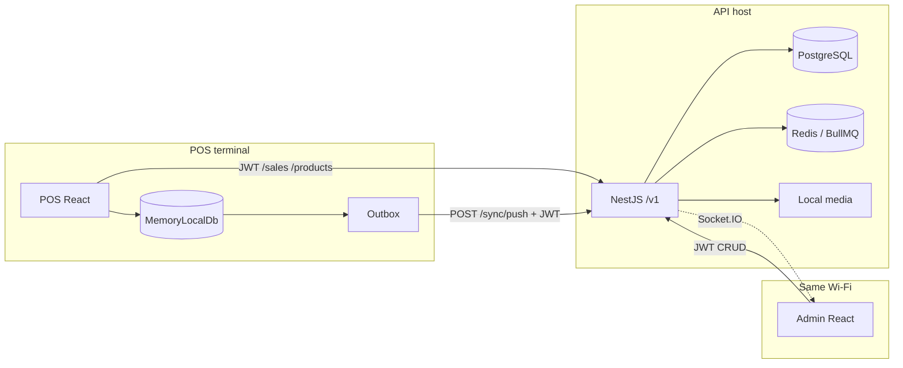
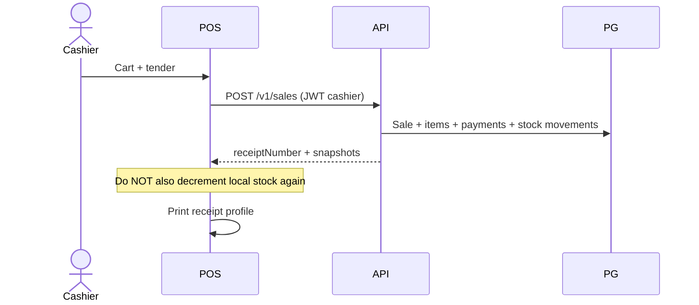
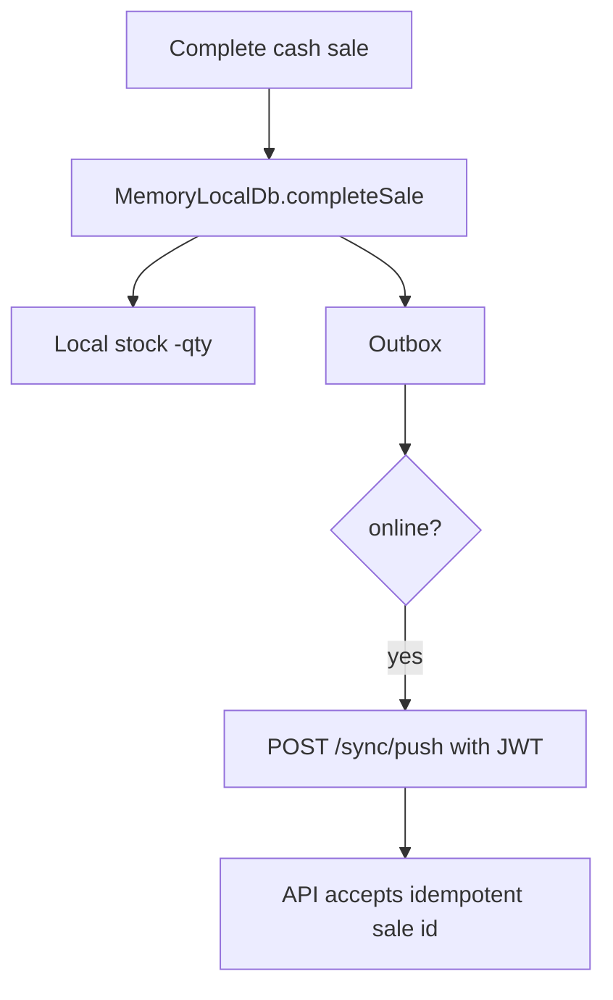
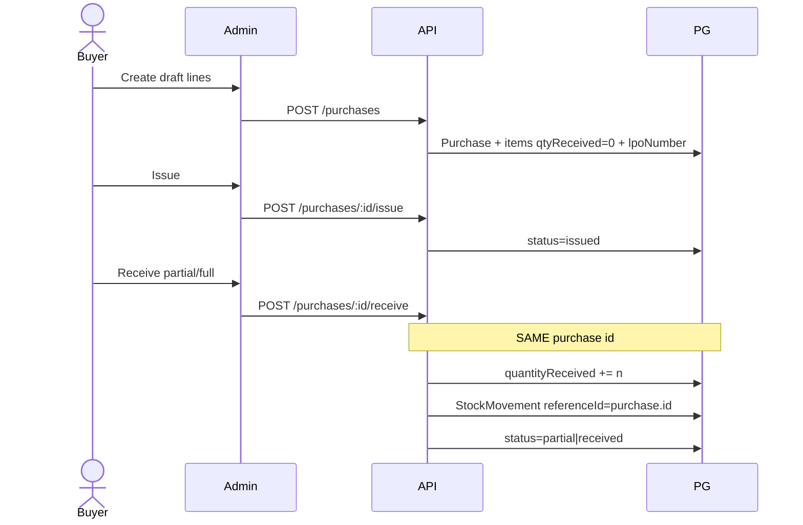
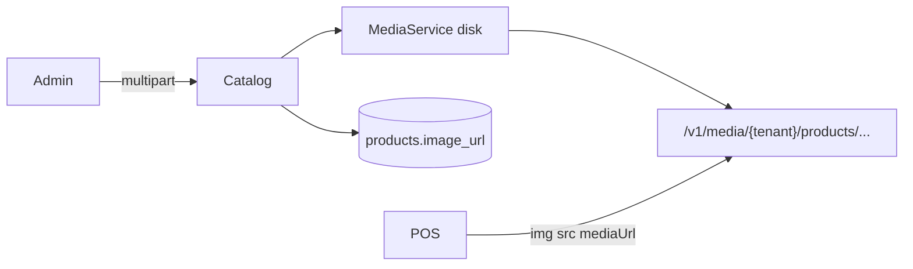

# SokoOS Data Flow

**Document:** SOKO-ARCH-FLOW-001  
**Depends on:** [Upgrade audit](../audit/sokoos-upgrade-audit.md), [Upgrade plan](./sokoos-upgrade-plan.md)

---

## 1. Runtime topology



POS may sell **cash** while offline. M-Pesa STK and eTIMS require network and must not be marked success offline.

---

## 2. Sale (online)



Cash stores `tenderedMinor` / `changeMinor`.  
M-Pesa payment may be `pending` until callback; sale may be `pending_payment` until completed allocations cover total.

---

## 3. Sale (offline cash)



---

## 4. LPO create → receive (same document)



Partial GRNs are multiple receive calls against one LPO. Cancel only if nothing received.

---

## 5. Product image



---

## 6. Inventory transfer

```mermaid
sequenceDiagram
  Admin->>API: POST /stock/transfers
  API->>PG: movement transfer OUT warehouse A
  API->>PG: movement transfer IN warehouse B
  Note over PG: Same correlationId; balances updated; no net create/destroy
```

---

## 7. Money and fiscal honesty

- Revenue = completed sale totals (not till cash).
- Gross profit ≈ revenue − product cost snapshots/costs (dashboard).
- Net profit needs expenses + full COGS — do not conflate.
- Local receipt ≠ eTIMS fiscal invoice until verified OSCU/VSCU confirmation.
